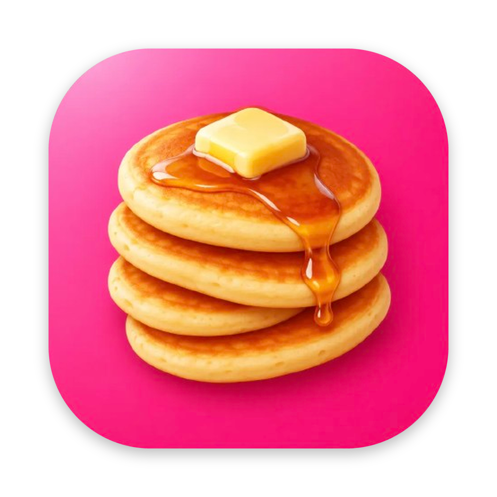

<p>
  
</p>

<h1>Pastry</h1>

<p>
  Win+V-style clipboard history for macOS.<br>
  Press <b>⌘⌥V</b> and your last 10 copies pop up right at your cursor 🥞
</p>

<p>
  
  
  
</p>

## Description

Pastry is a lightweight, open-source clipboard manager for macOS that works like Windows' Win+V. It quietly keeps your last 10 copies in a stack, and one shortcut opens a small panel right where your mouse is. Click an item and it's pasted into the app you were using. No setup, no accounts, and nothing is ever saved to disk.

## Features

- **One shortcut:** ⌘⌥V opens the panel at your cursor; press it again, hit Esc or click outside to close
- **Click to paste** straight into the app you were using
- **Keyboard friendly:** ↑ ↓ to move, Return to paste, 1–9 for quick picks, Delete to remove
- **A stack of 10:** newest on top, oldest drops off, copying something again moves it to the top
- **Keeps formatting:** text, rich text, images and Finder files paste back exactly as copied
- **Private by default:** history lives in memory only, is never written to disk or sent anywhere, and items marked private by password managers are skipped
- **Tiny:** native Swift, no dependencies, menu bar only (no Dock icon)

## Installation

### Requirements

- macOS 13 Ventura or newer
- An Apple Silicon (M1, M2, M3, M4…) or Intel Mac
- Apple's command line tools (skip if you already have Xcode):
  ```bash
  xcode-select --install
  ```

Not sure which chip you have? Click  → **About This Mac** and look at **Chip** (Apple M-series) or **Processor** (Intel).

### Apple Silicon (M-series) Macs

```bash
git clone https://github.com/<your-username>/pastry.git
cd pastry
bash build.sh
mv Pastry.app /Applications/ && open /Applications/Pastry.app
```

### Intel Macs

The steps are the same; `build.sh` automatically builds for the chip it runs on.

```bash
git clone https://github.com/<your-username>/pastry.git
cd pastry
bash build.sh
mv Pastry.app /Applications/ && open /Applications/Pastry.app
```

Intel Macs that can't update past macOS 12 Monterey (most models from before 2017–2018) aren't supported.

### Grant Accessibility access

1. Open **System Settings → Privacy & Security → Accessibility** and turn on **Pastry**. If it isn't listed, click **+** and choose `/Applications/Pastry.app`.
2. Quit Pastry from its menu bar icon and open it again.

A pancake icon appears in your menu bar. Copy a few things, press ⌘⌥V, and click one to paste it.

## Usage

| Action | How |
| --- | --- |
| Open / close the panel | ⌘⌥V |
| Paste an item | Click it, or select it and press Return |
| Quick paste | 1–9 |
| Move the selection | ↑ ↓ or hover |
| Remove an item | Delete, or right-click → Delete |
| Close | Esc or click outside |
| Clear history, open at login, quit | Menu bar icon |

## Privacy

Pastry needs Accessibility access only to simulate ⌘V when you pick an item. It has no network code, keeps history in memory, and forgets everything when it quits. It ignores clipboard items tagged with the [nspasteboard.org](http://nspasteboard.org) concealed or transient markers, which password managers like 1Password use.

## Customise

All settings are constants in the source; change them and rebuild.

| Setting | Where |
| --- | --- |
| Shortcut | `hotKeyCode` / `hotKeyModifiers` in `Sources/Pastry/AppDelegate.swift` |
| History size | `capacity` in `Sources/Pastry/ClipboardStore.swift` |
| Panel size | `size` in `Sources/Pastry/PanelController.swift` |
| App icon | `Resources/AppIcon.png` (1024×1024, transparent corners) |
| Menu bar glyph | `Resources/PancakeTemplate.png` (black on transparent) |

## Troubleshooting

- **Clicking an item doesn't paste:** Accessibility is off. Toggle Pastry off and on in Accessibility, then quit and reopen it.
- **Stopped pasting after a rebuild:** each local build has a new signature. Remove Pastry from Accessibility with **−**, add it again, and reopen.
- **⌘⌥V does nothing:** another app may own that shortcut. Change it (see Customise) and rebuild.
- **"Pastry can't be opened" on another Mac:** it was built for the other chip type. Build it on that Mac, or make a universal build (see above).
- **Old or blank icon:** run `killall Dock`.

**Uninstall:** quit Pastry, delete `/Applications/Pastry.app`, and remove it from Accessibility.